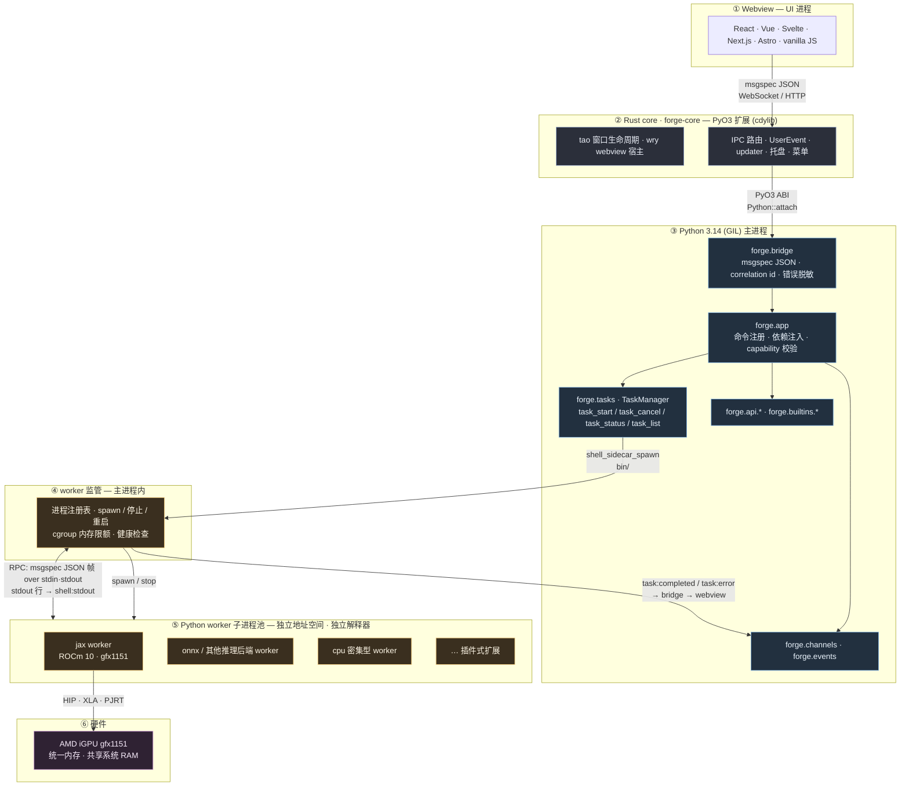
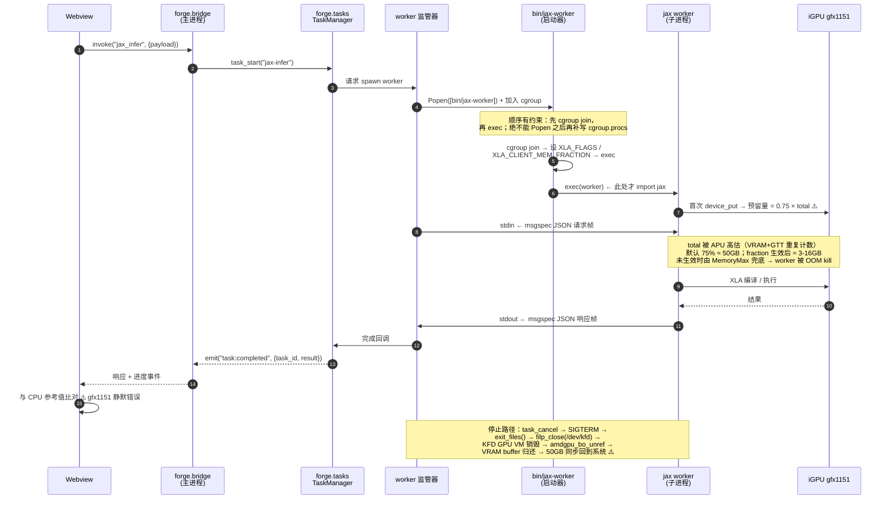

# AMD ROCm 10 + JAX 集成架构设计

> **文档类型**：架构设计提案（Feature Architecture Design）
> **状态**：Draft — 待评审
> **日期**：2026-11-13
> **适用范围**：ForgeDesk 桌面应用框架在 AMD APU（gfx1151 / Strix Halo）目标机上的本地 GPU 加速能力
> **关联文档**：[ARCHITECTURE.md](ARCHITECTURE.md)（通用框架架构）

---

## 0. 阅读指引

### 0.1 这份文档要回答什么

一个具体的工程问题：

> **ForgeDesk 应用需要在运行于 AMD iGPU（gfx1151）上的目标机器上调用 JAX 做 GPU 推理。AMD 官方当前的 ROCm 10 + JAX 栈存在若干已知限制，其中一个（`ROCm/jax#871`）会一次性占用约 50.5 GB 系统内存且在进程存活期内不释放。ForgeDesk 现有的架构假设全部是「进程内、无重型本地 GPU 运行时、内存占用可忽略」，这些假设在目标场景下全部失效。**

本文按以下顺序回答：

1. 上游现在到底支持什么（Python 版本、gfx1151 定位）？
2. 上游现在有哪些**未修复**的缺陷(PR #887)，开发者必须做哪些取舍？
3. `#871` 到底是什么，为什么「换 wheel」「改精度」都解决不了？
4. 需要对 ForgeDesk 做什么样的架构改造，才能在目标机上安全地跑 JAX？
5. 改造后的架构如何化解 `#871`？
6. 新架构相比当前仓库，**哪些是待开发的模块**？

### 0.2 结论速览

| # | 结论                                                                                                                                                                         | 证据                                                          |
| - | ---------------------------------------------------------------------------------------------------------------------------------------------------------------------------- | ------------------------------------------------------------- |
| 1 | **JAX ROCm 插件没有 free-threaded（`cp314t`）wheel**，只有 `cp311`–`cp314`。因此 worker 解释器必须是 **GIL 构建**。改名绕不过去（PEP 703）。              | 六个 AMD 发布通道穷举                                         |
| 2 | **ForgeDesk 已发布的 wheel 也是 `cp314`（GIL）**，与 worker ABI 一致，`pip install` 即可共存                                                                       | `pyproject.toml` / CI                                       |
| 3 | **gfx1151 不在 ROCm 10.1.0 的官方 JAX 支持矩阵里**，但编译器、运行时、wheel 均已就绪，属「兼容性矩阵已列出、release notes 未正式纳入」的过渡状态                       | `ROCm/jax` PR #887                                          |
| 4 | **gfx1151 有三个未修复缺陷**：fp16 `arcsin/asin` 静默错值且非确定性、4 个 dot 精度预设不受支持、Triton/Pallas LDS 64 KB 上限                                         | `ROCm/jax` PR #887（**未合并**）                      |
| 5 | **进程隔离不隔离数值缺陷**。这三个缺陷在 worker 里原样存在，必须在 worker 内做 CPU 参考比对                                                                            | 同上                                                          |
| 6 | **`#871` 的 50.5 GB 是 XLA 默认 `0.75+` 预分配策略 × APU 上被高估的 total device memory**，不是 JAX 泄漏，也不是「进程内无法回收」                                | 算术闭合 + XLA/JAX 官方文档 + `ROCm/legacy-rocm-build#6004` |
| 7 | **一级解法是 XLA 的 memory fraction 开关**（`--xla_gpu_memory_fraction_policy` / `XLA_CLIENT_MEM_FRACTION`），把 50 GB 在源头降到个位数 GB                         | XLA `docs/gpu_bfc_growth.md`                                |
| 8 | **二级解法（兜底）是「独立进程 + cgroup `MemoryMax` + SIGTERM」**：因为回收的因果链只存在于内核的进程销毁路径上，唯一可用的释放原语就是「杀掉持有 KFD 上下文的进程」 | 驱动释放路径分析                                              |
| 9 | **新架构需要新增 6 个待开发模块**，现有仓库已具备 spawn / 事件回流 / 任务事件三块可复用原语                                                                            | 见 §7                                                        |

### 0.3 证据索引

| 标识                                          | 类型                           | 地址                                                                              | 本文档引用处 |
| --------------------------------------------- | ------------------------------ | --------------------------------------------------------------------------------- | ------------ |
| `ROCm/jax#871`                              | Issue（OPEN，2026-11-11 更新） | https://github.com/ROCm/jax/issues/871                                            | §5          |
| `ROCm/jax#887`                              | PR（**OPEN，未合并**）   | https://github.com/ROCm/jax/pull/887                                              | §4          |
| `ROCm/legacy-rocm-build#6004`               | Issue（CLOSED）                | https://github.com/ROCm/legacy-rocm-build/issues/6004                             | §5.2        |
| `jax-ml/jax#39634`                          | PR（已合入 jaxlib 0.11.1）     | https://github.com/jax-ml/jax/pull/39634                                          | §2.5        |
| `openxla/xla` → `docs/gpu_bfc_growth.md` | 官方文档                       | https://github.com/openxla/xla/blob/main/docs/gpu_bfc_growth.md                   | §5.6        |
| JAX 文档 → GPU memory allocation             | 官方文档                       | https://docs.jax.dev/en/latest/201/gpu-memory.html                                | §5.6        |
| `ROCm/TheRock` → `RELEASES.md`           | 官方文档                       | https://github.com/ROCm/TheRock/blob/main/RELEASES.md                             | §2.5、§3.2 |
| torvalds/linux `5e70f6804b4d`               | 内核 commit                    | https://github.com/torvalds/linux/commit/5e70f6804b4d6256058c360b10e044ee04ea4a4e | §5.2        |
| AMD Strix Halo 系统优化指南                   | 官方文档                       | https://rocm.docs.amd.com/en/latest/reference/system-optimization/rdna3-5.html    | §9.3        |

---

## 1. 开发背景

### 1.1 目标场景

ForgeDesk 是一个 Python/Rust 混合的桌面应用框架：Rust 核心（PyO3）提供原生窗口与 WebView 宿主，Python 侧承载业务逻辑，Webview 通过 msgspec JSON over WebSocket/HTTP 调用 Python 命令。

当前官方 README 声称的运行特征是：

- 二进制约 22 MB，空闲 RSS 约 32 MB
- IPC p50 约 0.6 ms
- 对比 Electron：165 MB / 110 MB / 6 ms

这套「轻量」承诺是 ForgeDesk 的核心卖点。现在出现了一个新需求：

> **目标机器配置了支持 ROCm 10 的 AMD 处理器（iGPU），应用需要在本地做 GPU 推理（JAX）。**

这不是「加一个可选的加速后端」这么简单。JAX-on-ROCm 的运行时特征与 ForgeDesk 的全部前提假设都冲突：

| ForgeDesk 现有假设                 | JAX-on-ROCm 现实                                               |
| ---------------------------------- | -------------------------------------------------------------- |
| 进程内，无重型本地运行时           | JAX + ROCm runtime + PJRT + XLA + HIP，数百 MB 到数十 GB       |
| 内存占用可忽略（~32 MB）           | 一次 `device_put` 即可占用 ~50.5 GB 系统内存（`#871`）     |
| 单解释器（主进程 Python）          | ROCm 插件**只有 GIL wheel**；free-threaded 不可用（§2） |
| 第三方后端通过 capability 声明即可 | 后端有**架构级缺陷**，会静默产生错误数值（§4）          |
| 失败可由 `CircuitBreaker` 恢复   | 内存释放**没有进程内 API**，只能靠杀进程（§5）          |

### 1.2 目标硬件：AMD Strix Halo（gfx1151）

本文以最贴近生产的一档配置为基准：

| 项          | 值                                                                 |
| ----------- | ------------------------------------------------------------------ |
| GPU         | AMD Radeon 8060S Graphics（集成于 Ryzen AI MAX+ 395 / Strix Halo） |
| gfx target  | `gfx1151`                                                        |
| 架构        | RDNA 3.5，**APU / 统一内存**（无独立显存）                   |
| 内存        | 128 GiB LPDDR5X，CPU 与 GPU **共享同一块物理内存**           |
| OS / kernel | Fedora 7.1.10 / Linux 7.0（ROCm 10.3 nightly 目标）                |

**统一内存是本文所有内存讨论的物理前提。** 在 Strix Halo 上，GPU 的「VRAM」不是独立硬件，而是从系统 RAM 中划出来的：

- **VRAM pool**：BIOS carve-out，固定大小（AMD 建议 0.5 GB）。
- **GTT pool**：其余系统 RAM，通过 `amd-ttm` 暴露给 GPU。

两个池来自**同一块物理内存**，但分配语义完全不同。`ROCm/legacy-rocm-build#6004` 记录了这个陷阱：

> On a **discrete GPU**, VRAM and GTT are two separate physical memory pools — adding them is correct.
> On an **APU with unified memory** (gfx1151), this is misleading: […] these pools come from **the same physical hardware** — adding them implies 132 GiB of independently usable GPU memory, which is incorrect.

后果直接落在本文主题上：**JAX 在这台机器上申请的 50 GB「显存」，物理上就是用户的 50 GB 系统 RAM。** 这不是「显存不够」的问题，是「桌面被抽血」的问题。

### 1.3 为什么这件事在今天是一个需要专门设计的工程问题

三个约束同时成立，且互相放大：

1. **上游没有为 gfx1151 提供完整的 JAX 支持背书**（不在官方支持矩阵，见 §3）；
2. **上游明确知道 gfx1151 有三个缺陷但还没修**（PR #887 至今未合并，见 §4）；
3. **上游有一个未定位根因的内存问题**（`#871`，见 §5）。

第 1、2 条意味着：**开发者必须自己做数值正确性保证**，不能依赖「官方支持 = 正确」。
第 3 条意味着：**开发者必须自己在进程边界上做资源治理**，不能依赖「库自己会还内存」。

---

## 2. 上游现状（一）：ROCm 10 JAX 的 Python 版本支持

### 2.1 wheel 组成与版本对齐

ROCm 10 的 JAX 栈由三个包组成，**必须版本对齐**：

| 包                                 | 来源             | 说明                                                                  |
| ---------------------------------- | ---------------- | --------------------------------------------------------------------- |
| `jax_rocm10_plugin==<ver>`       | AMD nightly 索引 | XLA GPU 插件（`.so`），**含 ABI tag**，按 Python 版本分 wheel |
| `jax_rocm10_pjrt==<ver>`         | AMD nightly 索引 | PJRT 客户端，`py3-none`（纯 Python，无 ABI 约束）                   |
| `jax==<ver>` + `jaxlib==<ver>` | PyPI             | 上游 JAX                                                              |

> **坑点一**：`jax` 与 `jaxlib` 的 wheel **不包含** ROCm 后端，必须另外装 plugin。
>
> **坑点二**：在 ROCm 10 上，`jaxlib` 0.10.2–0.11.0 不知道 `jax_rocm10_plugin` 这个名字，GPU kernel 模块会解析成 `None`，FFI handler 不注册，表现为 `'NoneType' object has no attribute ...` 和 `No FFI handler registered for hipsolver_*`。修复在 jaxlib **0.11.1** 首次发布（`jax-ml/jax#39634`）。因此 **`jaxlib >= 0.11.1` 是硬性下限**。

### 2.2 结论：插件没有 free-threaded wheel

对 AMD 全部发布通道做了穷举审计（每个通道的 `/rocm/whl-next/` 路径 + gfx1151 专用通道）：

| 通道                                    | `jax-rocm10-plugin` 的 Python tag |
| --------------------------------------- | ----------------------------------- |
| `stable.repo.amd.com/rocm/whl-next/`  | cp311, cp312, cp313, cp314          |
| `nightly.repo.amd.com/rocm/whl-next/` | cp311, cp312, cp313, cp314          |
| `rc.repo.amd.com/rocm/whl-next/`      | cp311, cp312, cp313, cp314          |
| `dev.repo.amd.com/rocm/whl-next/`     | cp311, cp312, cp313, cp314          |
| `bkc.repo.amd.com/rocm/whl-next/`     | cp311, cp312, cp313, cp314          |
| `rocm.nightlies.amd.com/v2/gfx1151/`  | cp311, cp312, cp313, cp314          |

**没有 `cp314t`。**

作为对照，**上游 `jaxlib` 是有 free-threaded wheel 的**（自 0.7.1 起提供 `cp314-cp314t-manylinux_2_27_x86_64.whl`）。也就是说：

> **AMD 的 ROCm 插件是整条链路上唯一的阻塞点，而不是 Python 侧的问题。**

### 2.3 为什么改名绕不过去

一个直觉方案：把 `cp314-cp314` 的 wheel 重命名为 `cp314t`，骗过 pip 的 ABI 检查。**这条路在 PEP 703 下是死路**：

- free-threaded CPython 用 `Py_MOD_GIL_NOT_USED` 标记「本扩展已适配无 GIL 语义」。
- 若导入的 C 扩展**没有**这个标记，CPython 会在**导入时重新启用 GIL**，并发出 `RuntimeWarning`。
- 结果是一个「自称 NoGIL、实际持 GIL」的运行时——**比普通 GIL 构建更糟**：既拿不到并行收益，又让人误以为已经拿到。

因此结论是硬性的：

> **「NoGIL 主进程 + JAX ROCm 在同一解释器内」在今天不可能。**

### 2.4 对 ForgeDesk 的影响：主进程可以保持 GIL

好消息是这**不构成额外负担**：

- `pyproject.toml` 声明 `requires-python = ">=3.14"`；
- 官方发布的 `forgedesk` wheel 全部是 `cp314-cp314`（GIL 构建），CI（`.github/workflows/publish-python.yml`）用的是 `python-version: '3.14'`，即 GIL 构建；
- 因此 **GIL 3.14 是 pip 安装路径上的默认**，主进程与 worker 共享 cp314 ABI，wheel 可共存。

补充一点常被忽略的事实：

> 因为 JAX 已经隔离到子进程，**受限制的从来不是「JAX 与主进程同解释器」，而是「没有 cp314t 的 ROCm 插件」**。若将来 AMD 发布 cp314t 插件，主进程换成 3.14t 即可拿到 NoGIL 并行收益，**架构无需改动**——这正是「JAX 放独立进程」带来的额外收益。ForgeDesk源码构建用户（`maturin develop` 于 3.14t 解释器）今天就可以让主进程是 3.14t。

### 2.5 安装指令（gfx1151 目标机）

```bash
python3.14 -m venv .venv && source .venv/bin/activate

# 1. ForgeDesk
pip install forgedesk

# 2. ROCm 运行时（注意用 --index-url 而不是 --extra-index-url，
#    因为 nightly 索引不包含 jaxlib，混用会导致解析失败）
JAX_VERSION=0.12.0
ROCM_MAJOR=10

pip install --index-url https://nightly.repo.amd.com/rocm/whl-next/ \
    "rocm[libraries,device-gfx1151]"

# 3. JAX ROCm 插件与 PJRT（必须与 jax 同版本）
pip install --index-url https://nightly.repo.amd.com/rocm/whl-next/ \
    "jax_rocm${ROCM_MAJOR}_plugin==${JAX_VERSION}" \
    "jax_rocm${ROCM_MAJOR}_pjrt==${JAX_VERSION}"

# 4. 上游 JAX（PyPI）
pip install "jax==${JAX_VERSION}"

# 验证
python -c "import jax; print(jax.devices())"
# 期望：[RocmDevice(id=0)]
```

> **只做多架构安装时用 `--index-url`；要混装 PyPI 官方包时用 `--extra-index-url`。** 上面第 3 步故意用 `--index-url`，因为 plugin / pjrt 只存在于 AMD 索引；第 4 步单独走 PyPI。

---

## 3. 上游现状（二）：gfx1151 的支持状态

### 3.1 官方支持矩阵：不含 gfx1151

ROCm 10.1.0 release notes 中 JAX 的 GPU 支持列表：

| JAX 版本 | 官方列出的支持 GPU                                                  |
| -------- | ------------------------------------------------------------------- |
| 0.11.1   | gfx950, gfx942, gfx90a, gfx1200, gfx1201, gfx1100, gfx1101, gfx1102 |
| 0.11.0   | gfx950, gfx942, gfx90a                                              |
| 0.10.2   | gfx950, gfx942, gfx90a                                              |

**gfx1151 不在任何一行。**

### 3.2 但底层已经就绪

| 事实                                                                                                                      | 出处                         |
| ------------------------------------------------------------------------------------------------------------------------- | ---------------------------- |
| XLA 编译器已把 gfx1151 加入 `kSupportedGfxVersions`（早于 gfx1152/gfx1153 的加入）                                      | XLA 源码                     |
| ROCm 10 changelog 明写 *"Support for gfx1151 on Linux, complementing the previous support in the HIP SDK for Windows."* | ROCm 10 release notes        |
| 在 gfx1151（Strix Halo）上用 JAX 0.11.2 + TheRock ROCm 10.2 跑通了 **30,732 个测试**（8 个硬件相关失败被 skip）     | `ROCm/jax` PR #887         |
| TheRock 已为 gfx1151 发布 JAX wheel，device extra 为 `device-gfx1151`                                                   | `ROCm/TheRock` RELEASES.md |
| ROCm 10 的 nightly 通道提供 `0.11.2+rocm10.2.0`、`0.12.0+rocm10.3.0`                                                  | AMD nightly 索引             |

**结论**：gfx1151 上运行 JAX **在工程上可行**（编译器、运行时、wheel 均已就绪），但 AMD 尚未将其列入 ROCm 10 的 JAX「完全支持」清单。当前处于：

> **兼容性矩阵已列出，但 release notes 未正式纳入** 的过渡状态。

**可安装性受限**：stable 通道只有 `0.11.1+rocm10.1.0`，其 gfx 列表不含 gfx1151；**gfx1151 只能走 nightly 通道**。这意味着目标机依赖 nightly 构建，版本会持续漂移（nightly 的 `jax_rocm10_plugin` 版本号里带构建日期，如 `0.12.0+rocm10.3.0a20261113`）。

### 3.3 这对架构意味着什么

既然官方不背书 gfx1151，**应用层就必须自己承担正确性验证的责任**：

- 不能假设「装上就能跑对」；
- 数值缺陷的检测必须内置到运行时（§4.5），而不是靠用户报告；
- 版本漂移必须可回滚（nightly 依赖 → 需要锁定 wheel 版本并把版本写进诊断信息）。

---

## 4. 上游现状（三）：gfx1151 的三个未修复缺陷

### 4.0 缺陷清单的权威来源

**`ROCm/jax` PR #887 —「[ROCm] Skip gfx1151-specific test failures, gated by gfx target」**

| 字段        | 值                                                                                     |
| ----------- | -------------------------------------------------------------------------------------- |
| 状态        | **OPEN，未合并**（`mergedAt: null`）                                           |
| base / head | `rocm-jaxlib-v0.11.2` ← `fix/rocm-gfx1151-test-fixes`                             |
| 作者        | JehandadKhan                                                                           |
| 创建 / 更新 | 2026-10-01                                                                             |
| 测试环境    | gfx1151（Strix Halo, Radeon 8060S），JAX 0.11.2，TheRock ROCm 10.2.0a20261001          |
| 结果        | **30,732 passed, 8 failed** → 全部 skip 后 **0 failures, no regressions** |

PR 的关键价值在于：**它不修 bug，它精确刻画了 bug 的边界**，并且把 skip 严格 gate 在具体 gfx target 上（`is_device_rocm_gfx("gfx1151")`），使 MI300/gfx942、CUDA、TPU、CPU 仍然跑这些测试。这就是下文的规避方案来源。

> **重要**：PR #887 **未合并**。它描述的缺陷在当前 upstream HEAD 上依然存在。

### 4.1 缺陷一：fp16 `arcsin`/`asin` 静默错值且非确定性

**现象**（PR #887，`tests/lax_numpy_test.py`）：

```python
# TODO(rocm): The prebuilt ROCm wheel's gfx1151 (Strix Halo APU) backend
# computes float16 arcsin/asin incorrectly. The input here is exactly 1.0
# (the arcsin domain boundary, expected ~pi/2). On this device the float16
# result is wrong and non-deterministic across runs (observed values incl.
# NaN, 0.0 and ~5.5), while float32/float64 are correct and CPU is correct
# for all dtypes. Since jax.lax.asin lowers directly to chlo.asin, this is a
# backend codegen/numerics bug in the wheel, not fixable at the JAX/Python
# level.
```

| 属性     | 值                                                                                           |
| -------- | -------------------------------------------------------------------------------------------- |
| 触发条件 | `arcsin`/`asin` **且** dtype 为 float16 **且** 目标为 gfx1151                |
| 表现     | 结果错误，且**跨运行非确定性**（观测到 NaN、0.0、约 5.5 等）                           |
| 不受影响 | float32 / float64 正确；CPU 上所有 dtype 正确                                                |
| 根因     | `jax.lax.asin` 直接 lower 到 `chlo.asin`，是 **wheel 内的后端 codegen / 数值 bug** |
| 层级     | **JAX / Python 层无法修复**                                                            |

**规避方案（开发者必须做的取舍）**：

| 方案                          | 做法                                                     | 代价                           |
| ----------------------------- | -------------------------------------------------------- | ------------------------------ |
| **A. 提升精度（推荐）** | fp16 输入先 `.astype(jnp.float32)` 再算，再转回        | 显存占用翻倍；结果与 fp32 一致 |
| B. CPU 回退                   | 该算子放到 CPU 后端                                      | 需要跨设备传输；延迟不可控     |
| C. 预先避免                   | 上游做数值分析，凡是 `asin`/`arcsin` 路径一律用 fp32 | 同 A                           |
| D. 禁用                       | 应用层禁止使用 `asin`/`arcsin`                       | 功能受限                       |

> **强制约束**：在 gfx1151 上，`asin`/`arcsin` **必须**以 float32 或更高精度执行。若代码库里存在自动把常量/张量降到 fp16 的优化（常见于混合精度训练栈），必须显式排除这两个算子。

### 4.2 缺陷二：dot 精度预设不受支持

**现象**（PR #887，`tests/lax_test.py`）：

```python
# gfx1151 (Strix Halo) does not support all of the algorithms that are
# available on CUDA GPUs. The TF32 and the extended-precision BF16
# (X3/X6/X9) algorithms either fail to compile ("INTERNAL: No
# candidates could be compiled.") or are explicitly unimplemented
# ("UNIMPLEMENTED: Unsupported algorithm on the current device(s)").
# Only F16_F16_F32 and BF16_BF16_F32 from this set are supported on
# gfx1151, so skip the rest.
```

| dot preset           | gfx1151 | 失败模式                                       |
| -------------------- | ------- | ---------------------------------------------- |
| `DEFAULT`          | ✅      | —                                             |
| `F16_F16_F32`      | ✅      | —                                             |
| `BF16_BF16_F32`    | ✅      | —                                             |
| `TF32_TF32_F32`    | ❌      | `INTERNAL: No candidates could be compiled.` |
| `BF16_BF16_F32_X3` | ❌      | 同上 / `UNIMPLEMENTED`                       |
| `BF16_BF16_F32_X6` | ❌      | 同上 / `UNIMPLEMENTED`                       |
| `BF16_BF16_F32_X9` | ❌      | 同上 / `UNIMPLEMENTED`                       |

**规避方案**：

| 方案                                | 做法                                                                                                                     |
| ----------------------------------- | ------------------------------------------------------------------------------------------------------------------------ |
| **A. 用 `DEFAULT`（推荐）** | `lax.dot_general(..., precision=lax.DotAlgorithmPreset.DEFAULT)`，或干脆不指定 precision                               |
| B. 显式指定受支持的 preset          | 只在 `F16_F16_F32` / `BF16_BF16_F32` / `DEFAULT` 三者中选                                                          |
| C. 禁止高精度请求                   | 应用层拦截 `precision=jax.lax.Precision.HIGHEST` / `HIGH` 的调用（它们在 CUDA 上映射到 TF32，在 gfx1151 上必然失败） |

> **强制约束**：gfx1151 上不得请求 TF32，也不得请求 BF16 扩展精度（X3/X6/X9）。用 `Precision.HIGHEST` 表达「我要最高精度」的代码在 gfx1151 上必须改写。
>
> 另外注意：这是**编译期失败**，不是静默错误——相对安全，但会中断整条推理流水线，必须在 worker 侧捕获并降级重试。

### 4.3 缺陷三：Triton / Pallas 的 LDS 64 KB 上限

**现象**（PR #887，`tests/pallas/gpu_paged_attention_test.py`）：

```python
# The Triton kernel stages the K/V compute block in shared memory (LDS)
# with double buffering, so the LDS footprint scales with
# page_size * pages_per_compute_block * head_dim. The largest configs
# (page_size=32, head_dim=64, pages_per_compute_block=8) request ~80KB
# (81920 bytes), which exceeds the 64KB per-workgroup LDS that every AMD
# GPU exposes, and the compiler rejects it with RESOURCE_EXHAUSTED.
```

**LDS 预算模型**（PR 给出）：

```
LDS 占用 ≈ page_size × pages_per_compute_block × head_dim × 5 字节
```

其中系数 5 是实测值：双缓冲的 fp16 K + fp16 V + scales + 开销，约 5 字节/元素。

**设备上限**：

```python
# jax/_src/test_util.py (PR #887 新增)
ROCM_SHARED_MEMORY_LIMIT_BYTES = 64 * 1024
```

> 所有当前 JAX 面向的 AMD GPU（CDNA MI100/MI200/MI300 与 RDNA APU 如 gfx1151）**都**是每 workgroup 64 KB LDS。这不是 gfx1151 独有，是 AMD 全系。

**具体算例**：

| 配置                               | `page_size × pages_per_compute_block × head_dim` | LDS 估算          | 结果                      |
| ---------------------------------- | ---------------------------------------------------- | ----------------- | ------------------------- |
| page_size=32, head_dim=64, pages=8 | 16384                                                | 81,920 B ≈ 80 KB | ❌ `RESOURCE_EXHAUSTED` |
| page_size=16, head_dim=64, pages=4 | 4096                                                 | 20,480 B ≈ 20 KB | ✅                        |

**约束式**：

```
page_size × pages_per_compute_block × head_dim ≤ 65536 / 5 = 13107
```

**规避方案**：

| 方案                           | 做法                                                                                   |
| ------------------------------ | -------------------------------------------------------------------------------------- |
| **A. 缩小 tile（推荐）** | 保证 `page_size × pages_per_compute_block × head_dim ≤ 13107`                     |
| B. 改用 XLA 原生 attention     | `jax.nn.dot_general(..., implementation="xla")`，绕开 Triton/Pallas kernel，不占 LDS |
| C. 降 head_dim / 分页          | 在应用层拆分注意力计算                                                                 |

> **强制约束**：gfx1151（及全部 AMD GPU）上，**不得**使用超出 64 KB LDS 的 Triton/Pallas kernel 配置。
>
> 注意 `tests/pallas/ops_test.py` 中 dot kernel 的同类检查：(prod(lhs_shape) + prod(rhs_shape)) × dtype_size ≤ 65536。

### 4.4 三个缺陷的规避方案汇总

| 缺陷                     | 强制约束                                           | 失败模式                       | 检测手段              |
| ------------------------ | -------------------------------------------------- | ------------------------------ | --------------------- |
| fp16 `asin`/`arcsin` | 一律用 float32+                                    | **静默错误**（非确定性） | CPU 参考比对（强制）  |
| TF32 / BF16_X3,X6,X9 dot | 只用 `DEFAULT`/`F16_F16_F32`/`BF16_BF16_F32` | 编译期失败                     | 编译期捕获 + 降级重试 |
| LDS > 64 KB              | `page_size × pages × head_dim ≤ 13107`        | 编译期 `RESOURCE_EXHAUSTED`  | 编译期捕获 + 降级重试 |

**三类失败模式的性质完全不同，必须区别对待**：

- **缺陷一是静默的**——不崩溃、不报错，只是算错。这是三者中最危险的，因为它会污染下游一切。
- **缺陷二、三是响亮的**——编译期就失败，可以捕获。

### 4.5 把「静默错误」变成「可检测错误」：CPU 参考比对

由于缺陷一无法在 JAX 层修复，**唯一可行的防线是把静默错误转成显式错误**。

在 worker 侧引入一个可选的**校验模式**：

```python
def gpu_reference_check(fn, *args, atol=1e-3, rtol=1e-3, **kwargs):
    """在 gfx1151 上以 CPU 为参考验证 GPU 结果。

    背景：ROCm/jax#887 记录了 gfx1151 的 fp16 arcsin/asin 在 |x|==1 边界上
    静默错值且非确定性（NaN / 0.0 / ~5.5），而 fp32/fp64 与 CPU 均正确。
    该缺陷是 wheel 内 chlo.asin 的 codegen bug，无法在 JAX 层修复，
    只能靠运行时对照把静默错误转成显式失败。
    """
    gpu_val = jax.jit(fn)(*args, **kwargs)
    cpu_val = jax.jit(fn, device=jax.devices("cpu")[0])(*args, **kwargs)
    if not np.allclose(np.asarray(gpu_val, np.float32),
                       np.asarray(cpu_val, np.float32),
                       atol=atol, rtol=rtol):
        raise NumericalMismatchError(
            f"gfx1151 GPU/CPU 数值不一致：{fn.__name__}\n"
            f"  gpu={gpu_val}\n  cpu={cpu_val}"
        )
    return gpu_val
```

**运行策略建议**：

| 模式                        | 行为                                            |
| --------------------------- | ----------------------------------------------- |
| `off`（默认，生产）       | 仅在首次运行/版本变更后跑一次完整校验，结果缓存 |
| `sampled`（推荐，开发期） | 对关键算子按比例采样比对                        |
| `on`（CI / 发版前）       | 全量比对                                        |

**这条约束必须写进架构**：worker 的协议必须能表达「这次调用需要 CPU 参考比对」这个额外语义，而当前的 IPC 协议没有这个位置（见 §7.2）。

---

## 5. 上游现状（四）：`ROCm/jax#871` —— 进程存活期不释放的 50.5 GB

### 5.1 现象

**`ROCm/jax#871` —「Unusual memory usage on gfx1151」**（OPEN，作者 jrhip，2026-11-11 更新）

原始复现：

```python
import jax

jax.device_put(1, jax.devices('rocm')[0])
```

> Uses ~50.5 GB of memory which isn't attributed to the python process.
> This isn't released until killing the python process.
> Other than that, it seems to work correctly without error messages or incorrect calculation results.
> **Pytorch doesn't have this behaviour on the same rocm version.**

报告环境：

```
jax-rocm10-pjrt         0.11.1+rocm10.1.0a20260827
jax-rocm10-plugin       0.11.1+rocm10.1.0a20260827
jax:    0.11.1        jaxlib: 0.11.1        numpy: 2.4.4
python: 3.14.3 (Anaconda)
device: AMD Radeon 8060S Graphics-1, 1 local devices
OS:     Fedora 7.1.10-200.fc44.x86_64, kernel 6.17.0-14-generic
```

2026-11-11 的追加评论确认在 ROCm 10.3.0a20261111 上**行为不变**（只是警告信息变了）：

```
W1111 rocm_memory_bandwidth.cc:85] No SMI firmware peak for 0000:c2:00.0
      (amd-smi gpu_metrics reports no peak VRAM bandwidth
       (got 18446744073709551615)) is available from amd-smi/firmware.
```

### 5.2 根因：XLA 默认 75% 预分配 × APU 上被高估的 total device memory

`#871` 至今没有 AMD 回复，但三条独立证据交叉指向同一个解释。

**证据 A — 算术闭合。**

`ROCm/legacy-rocm-build#6004` 在**同一台机器**（Beelink GTR9 Pro，Ryzen AI MAX+ 395 / Radeon 8060S，128 GiB）上用独立 HIP 探针测得：

```
sysfs VRAM total:        0.50 GiB      # AMD 推荐的 low-carveout 配置
sysfs GTT total:       128.00 GiB
props.is_integrated:         1
props.total_memory:      62.47 GiB    # ← XLA 读到的 "device memory"
hip mem_get_info total:  62.47 GiB
```

而 JAX / XLA 的默认内存策略是 **`0.75+`**：

> **JAX will preallocate 75% of the total GPU memory when the first JAX operation is run, and the default pool can grow beyond that as needed.**
> When neither memory-fraction environment variable is set, JAX selects XLA's `0.75+` memory policy: an initial reservation of 75%, with a growth cap of 100% of total GPU memory.

对照算式：

```
62.47 GiB  = 67.08 GB
67.08 GB   × 0.75 = 50.31 GB      ← 与报告的 "~50.5 GB" 偏差 0.4%
```

**证据 B — 官方文档。**

XLA `docs/gpu_bfc_growth.md` 明确写着：

> The default memory policy retains a fixed cap of **75%** of device memory.

且 `0.75+` 解析为 `FlexMemFraction{0.75, 1.0}`（预分配 75%，可增长到 100%）。

**证据 C — 三个「怪现象」逐一对应。**

| 现象                                            | 机制解释                                                                                           |
| ----------------------------------------------- | -------------------------------------------------------------------------------------------------- |
| "not attributed to the python process"          | 分配经 KFD → amdgpu VRAM manager，物理页由驱动侧持有并记账在 kernel 侧，不在 Python 进程的 RSS 里 |
| "not released until killing the python process" | BFC 池归 `PjRtClient` 所有，**不存在 release API**；只有 client 析构（= 进程退出）才释放   |
| "Pytorch doesn't have this behaviour"           | PyTorch 的 ROCm caching allocator 按需申请，没有 75% 饿汉式预分配                                  |

**结论**：

> **`#871` 不是 JAX 泄漏，也不是「进程内无法回收」的固有限制，而是「XLA 默认预分配策略」与「APU 内存模型」两个通用组件相乘的结果。** 这一点决定了修复策略的优先级（§5.6 vs §5.7）。

**附带的系统级风险**：`#6004` 记录了 AMD 工程师的说明——该过度计数源于 `amd-ttm` 的 `ttm.pages_limit` 与 BIOS carve-out 变更不同步；已通过内核 commit `5e70f6804b4d` 修复（GTT 不再超过其物理支撑内存）。但 **BIOS carve-out 配置仍然直接决定这个数字**（见 §9.3）。

### 5.3 为什么「不在 Python 进程上」

分配链条：

```
XLA BFC allocator
  └─ hipMalloc(50 GB)
       └─ KFD_IOC_ALLOC_MEMORY        (ioctl on /dev/kfd)
            └─ amdgpu_vram_mgr / drm_buddy
                 └─ TTM buffer          ← 物理页来自系统 RAM（APU 上就是 LPDDR5X）
                      └─ KFD GPU VM (vma) 映射进该进程的 mm
```

物理页由**驱动的 VRAM manager** 持有并记账在 kernel 侧；进程 RSS 里只有很小的映射与页表开销。所以 `top` / `htop` / `smem` 看不到这 50 GB，但 `amd-smi` 的 VRAM/GTT 计数器和系统总内存都在涨。

**这一点是本设计的基石**：它意味着这 50 GB 的**释放触发器不在用户态，而在 fd 与 GPU VM 的销毁上**。

### 5.4 为什么「进程存活期不释放」

顺着上面的链条：

| 层级         | 现状                                                                                                                                 |
| ------------ | ------------------------------------------------------------------------------------------------------------------------------------ |
| XLA BFC 池   | 归 `PjRtClient` 生命周期；`memory_fraction` / `preallocate` 都是**创建期**参数，无运行时释放接口                         |
| JAX          | 无 `jax.release_device_memory()` 之类 API；池里 free 的 block 只回到 BFC 池 reuse，不回驱动                                        |
| XLA 官方说明 | 只有 `XLA_PYTHON_CLIENT_ALLOCATOR=platform` 是 *"the only configuration that will deallocate GPU memory, instead of reusing it"* |

**结论**：在进程内，唯一能让这 50 GB 消失的动作是 **销毁 client → 销毁进程的 GPU 上下文 → 进程退出**。

### 5.5 为什么「换个 wheel」解决不了

这是最容易被误判的一点，必须写清楚：

**`#871` 的现象不是某个 wheel 的 bug，而是 XLA 内存分配策略与 APU 内存模型的交互。** 证据：

- 同一个 issue 里，ROCm 10.1.0（2026-08 构建）和 ROCm 10.3.0（2026-11 构建）**行为完全一致**，只是警告文本变了；
- 复现用的 `jax.device_put(1, ...)` 是**最平凡的调用**——没有自定义 kernel、没有大张量、没有特殊编译选项；
- PyTorch 在**同一个 ROCm 版本**上不出现，因为它没有 75% 预分配这一步。

**所以换 wheel 只会改变具体数字（因为 total device memory 变了），不会消除这次分配。**

### 5.6 一级解法：XLA 的 memory fraction 开关

既然根因是「默认 0.75 策略」，就该在源头掐掉。官方提供了几个开关：

| 手段                                                               | 效果                                                                                                                                      | 来源                                                                                             |
| ------------------------------------------------------------------ | ----------------------------------------------------------------------------------------------------------------------------------------- | ------------------------------------------------------------------------------------------------ |
| **`XLA_FLAGS=--xla_gpu_memory_fraction_policy=0.05-0.25`** | 覆盖 BFC 分配器的策略。XLA 文档明说 *"overrides the client's setting for the BFC allocator and **works without any JAX change**"* | XLA `docs/gpu_bfc_growth.md`；flag 定义于 `xla/debug_options_flags.cc:2461`，proto field 560 |
| `XLA_CLIENT_MEM_FRACTION=0.1`                                    | BFC 固定上限 10%。**这是新名字**，`XLA_PYTHON_CLIENT_MEM_FRACTION` 已废弃但更可能被旧插件支持                                     | JAX 文档                                                                                         |
| `XLA_PYTHON_CLIENT_PREALLOCATE=false`                            | 关闭预分配。**注意**：BFC 下仍保留 75% 上限，除非同时设 fraction                                                                    | JAX 文档                                                                                         |
| `XLA_PYTHON_CLIENT_ALLOCATOR=platform`                           | **唯一会真正 deallocate 而非 reuse 的模式**。但 *"very slow, not recommended for general use"*                                    | JAX 文档                                                                                         |

在 62.47 GiB 的 total 上：

```
0.05 → ~3.1 GB
0.25 → ~15.6 GB
```

**预期效果**：50 GB → 个位数 GB。

**必须实测的注意事项**：

1. XLA 文档写明 *"Non-spatial pools, **unified memory**, and other allocator kinds retain their existing behavior."* Strix Halo 跑在统一内存下，**某些开关可能对造成 50 GB 的那个池不生效**。
2. `jax_rocm10_pjrt` 是 AMD 自建的 XLA fork，其 pin 的 XLA 版本决定新式 `--xla_gpu_memory_fraction_policy` flag 是否存在；旧式 float 版 `memory_fraction` 支持面更广。
3. **建议两个环境变量名都设**（新名 + 废弃名），以覆盖不同插件版本。

**因此 §5.6 与 §5.7 不是二选一，而是叠加**：前者减少峰值，后者保证「万一没生效也不至于拖垮桌面」。

### 5.7 二级解法（兜底）：独立进程 + cgroup 限额 + SIGTERM

这是本设计的核心。**它有效的原因不在于「减少了内存」，而在于三条机制各自补上了 `#871` 的一个不可绕过的属性。**

#### (a) 独立进程 —— 解决「回收动作的作用域」

驱动的 VRAM buffer 归属于**打开 `/dev/kfd` 并发起分配的那个进程的 GPU VM**。隔离之后：

|                | 不隔离                       | 隔离后               |
| -------------- | ---------------------------- | -------------------- |
| 谁持有 50 GB   | GUI 主进程                   | worker 子进程        |
| 主进程内存曲线 | 整机内存被抽走（RSS 看不到） | 恒定 ~32 MB          |
| 谁能触发回收   | 只能等用户退出整个应用       | supervisor 随时可以  |
| 回收时延       | 几小时                       | 一次 SIGTERM，毫秒级 |

**关键不是「省内存」，而是把回收动作从「应用生命周期事件」降级为「worker 生命周期事件」。**

#### (b) cgroup v2 `MemoryMax` —— 解决「万一涨过头，谁死」

在 Strix Halo 上，这 50 GB 就是用户 RAM。如果不管它，内核 OOM killer 的受害者是**随机**的——可能是 compositor、可能是编辑器、可能是数据库。桌面直接黑屏、丢会话。

cgroup v2 把这件事改成确定性事件：

```
系统 RAM 被耗尽
  ├─ 无 cgroup:  OOM killer 全局选随机受害者 → 桌面崩，工作丢失
  └─ 有 cgroup:  mem_cgroup_out_of_memory() → 只在 worker 的 cgroup 内选 victim
                                          → worker 被杀
                                          → fd 销毁 → 驱动释放 VRAM → 50 GB 归还
                                          → 桌面毫发无损
```

**注意这里的闭环**：cgroup OOM 杀 worker 之所以能顺带还内存，正是靠 §5.3 的性质（回收触发器 = fd 销毁）。限额不是单纯「限住」，而是把「随机受害者」换成「已知受害者」，而这个受害者一死，内存自动归位。

还有第二层收益：若分配本身在限额下拿不到那么多页（charge 失败），XLA 侧的行为是文档写明的——

> If that much memory is not available, the initial region shrinks like a fixed pool does, with a warning.

即 worker 的 XLA client 可能带着**缩水的池**起来，或干脆起不来。两种都是可接受结果：**worker 起不来，远好过桌面死掉。**

> **关键实现约束（决定成败）**：worker 必须在**创建 device context 之前**加入 cgroup。若先 `Popen` 再补写 `cgroup.procs`，分配可能已经记在父进程账上，限额形同虚设。正确做法是让 `bin/` 下的**启动器脚本**在 `exec` 之前完成 cgroup join。

#### (c) SIGTERM —— 解决「回收的时机与可观测性」

```
supervisor: stop(worker)
   └─ SIGTERM
        └─ Python 走正常退出路径
             ├─ flush stdout → 最后一条 RPC 状态帧不丢（协议完整性）
             ├─ atexit / 清理逻辑能跑
             └─ exit_files() → filp_close(/dev/kfd)
                              → KFD GPU VM 销毁
                              → amdgpu_bo_unref → drm_buddy_free
                              → TTM buffer 归还 → 50 GB 回到系统
   └─ waitpid() 返回
        → 内存**已经**归还（释放发生在进程销毁过程中，不是异步的）
        → shell:exit {pid, code} → supervisor 确认
```

两个要点：

1. **回收是同步的。** 释放发生在 `waitpid()` 返回之前。所以「停 worker」是一个**同步、可观测、可等待**的操作——这正是它能当控制原语用的原因。
2. **SIGKILL 也能还内存，但它只解决「还」，不解决「干净地停」。** 内核的 `do_exit()` 对信号 9 一样执行 `exit_files()`。选 SIGTERM 的理由是让 worker 有机会写完最后的响应帧（否则 supervisor 无法区分「正常完成」与「崩溃」）、让退出码有意义。**对已经 hang 住的 worker，SIGTERM → 超时 → SIGKILL 是完全正当的升级路径，内存照样归还。**

#### (d) 合起来换来了什么性质

回到 `#871` 的每一个「坏性质」：

| `#871` 的性质              | 被哪个机制中和                                                    |
| ---------------------------- | ----------------------------------------------------------------- |
| 进程存活期内只增不减         | 终止进程 → fd 销毁 → 驱动释放 VRAM buffer                       |
| 内存不可见，app 自己察觉不到 | 独立进程 → app 从不持有 GPU fd，内存曲线是平的                   |
| 可能饿死整个桌面             | cgroup `MemoryMax` → OOM victim 确定是 worker，且其死亡即归还  |
| 何时归还完全不可控           | supervisor 主动 SIGTERM → 同步、可等待、经 `shell:exit` 可观测 |
| 归还的粒度不可控             | 进程粒度 = 唯一可用粒度 → worker 必须被建模为一次性资源          |

**最终故障模式的变化**：

> 从「应用会话期间持续被抽走 50 GB，且用户没有任何手段干预」
> 变成「worker 在其任务期间最多占用 `MemoryMax` 字节，停止的瞬间归还」。

这是一个 **lease（租约）**，不是 **leak（泄漏）**。有明确上限、有明确释放时刻的资源，才可以被调度和推理；泄漏不行。

### 5.8 这套兜底不解决什么

必须写进文档，避免误用：

- **50 GB 在 worker 存活期间依然会发生**（除非 §5.6 的开关生效）。有效峰值只是从「不可控」变成 `min(50 GB, MemoryMax)`。
- **若驱动侧页未计入 worker cgroup，`MemoryMax` 不构成硬顶**——必须实测（§10.2）。
- **上游根因未修**：`#871` 仍是 OPEN，AMD 未回应。这是权宜之计，不是修复。
- **数值缺陷不受影响**：§4 的三个缺陷在 worker 里原样存在。**进程隔离只管住了内存，管不住算错。**

---

## 6. 目标架构

### 6.1 设计原则

| #  | 原则                                          | 理由                                                             |
| -- | --------------------------------------------- | ---------------------------------------------------------------- |
| P1 | **JAX 必须在独立进程**                  | 回收粒度 = 进程粒度（§5.7a）；且使主进程未来可切 3.14t（§2.4） |
| P2 | **进程边界 = 资源治理边界**             | 限额、健康检查、重启都以进程为单位                               |
| P3 | **释放必须是显式动作，不能是「等 GC」** | `#871` 没有进程内释放路径（§5.4）                             |
| P4 | **失败必须局部化**                      | worker 崩溃不得影响桌面；worker 的数值异常必须被检出             |
| P5 | **iGPU 上只允许一个 JAX worker**        | N 个 worker = N 份 KFD context = N 份预分配（§5.2）             |

### 6.2 主架构图



**图例**：绿 = 现有能力 · 橙 = 待开发 · 灰蓝 = Rust 核心 · 紫 = 硬件

### 6.3 IPC 通信流程图（修正版）



### 6.4 一次推理调用的完整生命周期

| 阶段            | 动作                                                                                      | 内存状态                                                             |
| --------------- | ----------------------------------------------------------------------------------------- | -------------------------------------------------------------------- |
| T0 应用启动     | 主进程**不** import jax，不打开 `/dev/kfd`                                        | 主进程 ~32 MB，无 GPU 占用                                           |
| T1 前端发起     | `invoke("jax_infer", {...})` → bridge → `TaskIPC`                                   | —                                                                   |
| T2 调度         | `TaskManager` 判定需要进程型任务 → supervisor                                          | —                                                                   |
| T3 spawn        | `Popen([bin/jax-worker])` → **启动器**加入 cgroup → 设 fraction env → `exec` | 仍为 0                                                               |
| T4 设备初始化   | worker `import jax` → `jax.devices('rocm')` → XLA 预分配                            | **峰值**：0.75×total（fraction 生效则 3–16 GB，否则 ~50 GB） |
| T5 计算         | stdin 收帧 → XLA 编译/执行 → stdout 回帧                                                | 稳态                                                                 |
| T6 结果         | `task:completed` → bridge → webview；UI 侧做 CPU 参考比对                             | 稳态                                                                 |
| T7 停止         | `task_cancel` → SIGTERM → 进程销毁 → 驱动释放 → 内存归还                            | **归零**（同步）                                               |
| T8 重启（可选） | supervisor 收到 `shell:exit` → 按策略重新 spawn                                        | 回到 T3                                                              |

### 6.5 内存生命周期与回收语义（新架构的核心契约）

```
        spawn                init              running            stop
  ──────┬──────────────────────┬───────────────────┬───────────────┬────────►
        │                      │                   │               │
        ▼                      ▼                   ▼               ▼
   cgroup join           设备预分配峰值         稳态占用      fd 销毁 → 释放
   (在 import 前)        (受 fraction 与        (受任务大小     (同步、可观测)
                          MemoryMax 双重约束)    影响)
```

**契约三条**：

1. **任何时刻 GPU 侧占用 ≤ `MemoryMax`**（前提：驱动侧页计入 worker cgroup，需实测 §10.2）。
2. **停止后 GPU 侧占用归零，且同步完成**——`waitpid()` 返回即已释放。
3. **worker 是可抛弃的**——它随时可以被 SIGTERM 杀掉并重新拉起，状态不跨进程保留。

---

## 7. 新架构 vs 当前仓库：待开发模块清单

### 7.1 现有能力盘点（可直接复用）

| 能力                 | 位置                                               | 说明                                                                                     |
| -------------------- | -------------------------------------------------- | ---------------------------------------------------------------------------------------- |
| 子进程 spawn         | `forge/api/shell.py:132` `_spawn_process()`    | `subprocess.Popen(cmd_list, stdout=PIPE, stderr=PIPE, text=True, bufsize=1)`           |
| sidecar 路径白名单   | `forge/api/shell.py:83` `_get_sidecar_path()`  | 路径固定 `<base_dir>/bin/<name>`，由 `[permissions.shell].sidecars` 管控             |
| sidecar spawn 命令   | `forge/api/shell.py:180` `shell_sidecar_spawn` | 已注册为 IPC 命令                                                                        |
| stdout/stderr 事件流 | `forge/api/shell.py:142,145`                     | `shell:stdout` / `shell:stderr`，带 `pid`                                          |
| 退出事件             | `forge/api/shell.py:156`                         | `shell:exit`，带 `pid` 与 `code`——**回收完成的可观测信号**                 |
| 任务事件回流         | `forge/tasks.py:225` `_emit_task_event()`      | `task:completed` / `task:error` → `app.emit()` → bridge → webview               |
| 任务管理 API         | `forge/tasks.py:64` `TaskManager`              | `start` / `cancel` / `cancel_group` / `cancel_all` / `status` / `list_tasks` |
| IPC 任务命令         | `forge/app.py:287` `TaskIPC`                   | `task_start` / `task_cancel` / `task_status` / `task_list`，capability `tasks` |
| 权限配置             | `forge/config.py:167` `ShellPermissions`       | `execute` / `deny_execute` / `sidecars` / `allow_urls` / `deny_urls`           |

**结论：spawn、事件回流、任务事件三块原语已经就位，改造量主要在「进程型任务」和「监管器」两块。**

### 7.2 待开发模块

#### P0 — 阻塞最小可用

| #    | 模块                    | 目标位置                            | 需求                                                                                                                                                                                                                | 依赖       |
| ---- | ----------------------- | ----------------------------------- | ------------------------------------------------------------------------------------------------------------------------------------------------------------------------------------------------------------------- | ---------- |
| P0-1 | **进程型任务**    | `forge/tasks.py`                  | `TaskManager` 目前**只有 `threading.Thread`**（`forge/tasks.py:162`），需支持 `subprocess` 型任务：`TaskRecord` 增加 `process` 字段，状态机增加 `STOPPING`，`cancel()` 对进程发 SIGTERM       | —         |
| P0-2 | **stdin 管道**    | `forge/api/shell.py:136`          | `Popen` 当前**未开 `stdin`**。需 `stdin=PIPE` + 帧读写线程                                                                                                                                              | —         |
| P0-3 | **worker 启动器** | `<base_dir>/bin/forge-jax-worker` | 脚本形态（sidecar 要求可执行文件在 `bin/` 下）。职责：① 加入 cgroup ② 设置 `XLA_FLAGS` / `XLA_CLIENT_MEM_FRACTION` / `XLA_PYTHON_CLIENT_PREALLOCATE` ③ `exec` 真正的 worker                            | P0-1       |
| P0-4 | **worker 监管器** | 新增 `forge/workers.py`           | 进程注册表（pid ↔ task_id ↔ 元数据）、spawn / stop / restart / 健康检查、`shell:exit` 事件驱动的重启策略、启动超时                                                                                              | P0-1, P0-3 |
| P0-5 | **RPC 帧协议**    | 新增 `forge/workers/protocol.py`  | msgspec JSON 帧 over stdin/stdout。帧类型：请求（`id`, `method`, `params`）、响应（`id`, `result` / `error`）、事件（`progress`）。**必须支持 `reference_check` 参数**（§4.5）与 `timeout` | P0-2       |

#### P1 — 正确性与可运维性

| #    | 模块                   | 目标位置                 | 需求                                                                                                                                                 |
| ---- | ---------------------- | ------------------------ | ---------------------------------------------------------------------------------------------------------------------------------------------------- |
| P1-1 | **cgroup 限额**  | `forge/workers.py`     | cgroup v2：创建 worker 专属 cgroup，`memory.max`（= `MemoryMax`）、`memory.high`、`memory.oom.group=1`。**必须在 spawn 之前完成 join** |
| P1-2 | **数值校验开关** | worker 侧                | `off` / `sampled` / `on` 三档；实现 §4.5 的 `gpu_reference_check`                                                                           |
| P1-3 | **dot 精度守卫** | worker 侧                | 拦截 `Precision.HIGHEST` / `HIGH`，在 gfx1151 上强制降为 `DEFAULT`，并可重试                                                                   |
| P1-4 | **gfx 能力探测** | worker 侧                | 读 `device.compute_capability`（ROCm 上即 gfx ISA 名），据此**动态**应用 §4 的约束，而非硬编码 gfx1151                                      |
| P1-5 | **诊断信息**     | `forge/diagnostics.py` | 上报 JAX / plugin / pjrt 版本、gfx target、fraction 配置、实测显存峰值——nightly 通道版本会漂移，诊断必须能区分                                     |

#### P2 — 规模化与体验

| #    | 模块                   | 需求                                                                                                     |
| ---- | ---------------------- | -------------------------------------------------------------------------------------------------------- |
| P2-1 | **worker 池**    | 多后端（onnx / CPU）共用同一监管器；但 **JAX worker 在 iGPU 上限为 1**（P5）                       |
| P2-2 | **预热与保温**   | fraction 开关生效后，保温（保持 worker 存活）以换取低延迟；否则只能「用完就杀」，每次付设备初始化 + 峰值 |
| P2-3 | **IPC 协议扩展** | 把 worker 调用抽象为通用 `TaskKind.PROCESS`，让 `forge/tasks.py` 对上层的语义统一                    |

### 7.3 明确不改动 / 不依赖的部分

| 项                       | 说明                                                                                                                                      |
| ------------------------ | ----------------------------------------------------------------------------------------------------------------------------------------- |
| Rust 核心（`src/`）    | **无需任何改动**。IPC 路由、事件循环、WebView 全部与本设计正交                                                                      |
| `forge/bridge.py` 协议 | 请求/响应格式（`command` / `id` / `args` → `type`/`protocol`/`id`/`result`）**不变**；只是 `task_start` 的语义扩展 |
| Webview 前端             | 现有 `invoke` / 事件订阅 API **不变**                                                                                             |
| 主进程解释器             | **保持 GIL 3.14**，与 worker 共享 cp314 ABI（§2.4）                                                                                |
| 零拷贝内存通道           | `forge.memory` / `forge-memory://` 机制不变；大张量可复用该通道避免 JSON 序列化                                                       |

---

## 8. IPC 流程对应关系

### 8.1 当前仓库的 IPC 流程（`ARCHITECTURE.md` → Data Flow → IPC Communication Flow）

```
1. Frontend (JS)
   └── window.__forge__.invoke("command", args)
       └── WebSocket/HTTP message

2. Rust Core (native_window.rs)
   └── IPC handler receives message
       └── Calls Python callback via PyO3

3. Python Bridge (bridge.py)
   └── Receives JSON message
       └── Validates command name
       └── Checks capabilities
       └── Dispatches to handler

4. Command Handler
   └── Executes business logic
       └── Returns result

5. Response Flow
   └── Python → JSON → Rust → WebSocket → Frontend
```

### 8.2 新架构的对应与扩展

| 当前步骤                                   | 新架构                                                                                                                                                                        | 状态                |
| ------------------------------------------ | ----------------------------------------------------------------------------------------------------------------------------------------------------------------------------- | ------------------- |
| ① `invoke("command", args)`             | `invoke("jax_infer", {payload, reference_check})`                                                                                                                           | ✅ 不变，仅参数扩展 |
| ② WebSocket/HTTP → Rust → PyO3          | 完全相同                                                                                                                                                                      | ✅ **零改动** |
| ③ `bridge.py` 校验/派发                 | `TaskIPC.task_start` 需支持**参数化**任务（当前 `forge/app.py:290` 的 `task_start(name, interval)` 只支持 ticker / 常驻，**无法从 IPC 提交任意 callable**） | ⚠️ 需扩展         |
| ④ Command Handler 执行业务逻辑            | **分叉点**：• 轻量命令 → 主进程内执行（不变）• 重任务 → 交给 supervisor → worker 进程                                                                              | ⚠️ 需新增分支     |
| ⑤ 响应流 Python→JSON→Rust→WS→Frontend | 主响应流不变；**新增** worker 帧通道：stdin（请求）↔ stdout（响应）                                                                                                    | ⚠️ 需新增         |

### 8.3 两条通道的职责边界（必须分清）

这是本设计最容易混淆的地方，明确如下：

| 通道                                      | 承载                                                                                                  | 方向                                      | 现状                        |
| ----------------------------------------- | ----------------------------------------------------------------------------------------------------- | ----------------------------------------- | --------------------------- |
| **Webview ↔ 主进程**（既有）       | 用户界面与业务命令                                                                                    | 双向，msgspec JSON over WS/HTTP           | ✅ 已有                     |
| **主进程 ↔ worker**（新增）        | 推理请求与结果                                                                                        | 双向，msgspec JSON 帧 over stdin/stdout   | ⚠️ 需新增                 |
| **`forge/tasks.py` 事件**（既有） | **生命周期与事件回流**：`task:completed` / `task:error` / `shell:stdout` / `shell:exit` | worker → supervisor → 主进程 → webview | ✅ 已有，**直接复用** |

> **`forge/tasks.py` 承载的是「生命周期与事件回流」，不是「请求/响应传输」。**
> 请求/响应必须另建通道（stdin/stdout 帧）。架构图里把两者画成不同的边，正是这个原因。

### 8.4 两条通道如何配合完成一次调用

```
① Webview  --invoke("jax_infer")-->  bridge  --task_start-->  TaskManager
                                                            │
                                              进程型任务 → supervisor
                                                            │
                                                    spawn(cgroup join)
                                                            │
        stdin ← 请求帧 ────────────────────────────────►  worker
        stdout → 响应帧 ────────────────────────────────►  supervisor
                                                            │
                                             task:completed 事件
                                                            │
   Webview ◄── 响应 + 进度事件 ──────────────────  bridge ◄┘
```

**注意**：`task:completed` 事件与响应帧是**两条独立的路径**。事件走既有的 `forge/tasks.py` → `app.emit()` → bridge 链路；结果数据走 stdout 帧。这条分工保证了**即使 worker 在写完结果后立刻崩溃，事件链依然能携带失败原因**。

---

## 9. 配置与运维

### 9.1 `forge.toml` 配置片段（提案）

```toml
[permissions.shell]
# 必须显式允许 worker sidecar
sidecars = ["forge-jax-worker"]

[permissions]
tasks = true          # 已有默认值

[workers]
enabled = true

[workers.jax]
launcher = "bin/forge-jax-worker"
# 兜底上限。必须显著大于 fraction 生效后的实际占用，
# 小于 0.75 × total（APU 上通常 40-60 GB）
memory_max = "24G"
memory_high = "20G"     # 软限：触发回收压力
oom_group = true        # cgroup 内 OOM 时整体被杀，保证 VRAM 一次释放
restart = "on-failure"
max_restarts = 3
startup_timeout = 120   # 设备初始化 + XLA 编译，可能很慢
shutdown_grace = 10     # SIGTERM → SIGKILL 的宽限期
```

### 9.2 启动器内的环境变量

```bash
#!/usr/bin/env bash
# bin/forge-jax-worker —— 顺序至关重要

# 1) 先加入 cgroup（必须在 import jax 之前）
#    由 supervisor 通过环境变量 FORGE_CGROUP_PATH 传入
if [ -n "${FORGE_CGROUP_PATH}" ] && [ -w "${FORGE_CGROUP_PATH}/cgroup.procs" ]; then
    echo $$ > "${FORGE_CGROUP_PATH}/cgroup.procs"
fi

# 2) 再设内存策略（一级解法，§5.6）
export XLA_FLAGS="${XLA_FLAGS} --xla_gpu_memory_fraction_policy=${FORGE_MEM_FRACTION_POLICY:-0.05-0.25}"
export XLA_CLIENT_MEM_FRACTION="${FORGE_MEM_FRACTION:-0.05}"
export XLA_PYTHON_CLIENT_MEM_FRACTION="${FORGE_MEM_FRACTION:-0.05}"   # 废弃名，覆盖旧插件
export XLA_PYTHON_CLIENT_PREALLOCATE=false

# 3) 可选：platform allocator 是唯一会真正 deallocate 的模式，但很慢
# export XLA_PYTHON_CLIENT_ALLOCATOR=platform

# 4) 最后才 exec —— 此刻才 import jax
exec python -m forge_worker.jax
```

### 9.3 目标机前置条件（务必先做）

| # | 前置条件                                          | 理由                                                                                                 | 出处                               |
| - | ------------------------------------------------- | ---------------------------------------------------------------------------------------------------- | ---------------------------------- |
| 1 | **BIOS VRAM carve-out 调小到 0.5 GB**       | carve-out 越大，driver 报的 total 越大，0.75 预分配越离谱。96 GiB carve-out 会让 total 报到 ~220 GiB | AMD Strix Halo 优化指南；`#6004` |
| 2 | kernel ≥ 6.15（建议 6.17+）                      | 包含 `5e70f6804b4d`：GTT 不再超过其物理支撑内存，消除过度计数                                      | `#6004`                          |
| 3 | 确认 `props.total_memory` 实际值                | 决定 0.75 预分配的绝对量。目标是把 total 降到 ~60 GiB 量级                                           | `#6004` 的 HIP 探针              |
| 4 | cgroup v2 统一层级（`cgroup.controllers` 存在） | `memory.max` / `memory.oom.group` 依赖 cgroup v2                                                 | Linux 内核文档                     |
| 5 | 锁定 nightly wheel 版本                           | nightly 索引版本随日期漂移；生产环境必须 pin                                                         | AMD nightly 索引                   |

---

## 10. 验证清单

### 10.1 装机验证

```bash
python - <<'EOF'
import jax, jaxlib, subprocess
print("jax     ", jax.__version__)
print("jaxlib  ", jaxlib.__version__)
d = jax.devices("rocm")
print("devices ", d)
print("gfx     ", d[0].compute_capability)   # ROCm 上即为 gfx ISA 名
EOF
```

**期望**：`gfx1151`。

### 10.2 `#871` 复现与对照实验（决定性）

**这一步同时验证根因假设并解决问题，必须在目标机执行。**

```bash
# 基线：复现 50 GB
python -c "import jax; jax.device_put(1, jax.devices('rocm')[0])" &
PID=$!
sleep 20
echo "--- amd-smi ---";  amd-smi --showmeminfo vram
echo "--- cgroup ---";   cat /sys/fs/cgroup/.../memory.current
echo "--- ps ---";       ps -o rss= -p $PID
wait $PID
```

**然后加策略重跑**：

```bash
XLA_FLAGS=--xla_gpu_memory_fraction_policy=0.05 \
XLA_CLIENT_MEM_FRACTION=0.05 \
XLA_PYTHON_CLIENT_MEM_FRACTION=0.05 \
XLA_PYTHON_CLIENT_PREALLOCATE=false \
  python -c "import jax; jax.device_put(1, jax.devices('rocm')[0])"
```

**判定**：

| 观测                                        | 结论                                                                                                      |
| ------------------------------------------- | --------------------------------------------------------------------------------------------------------- |
| 分配量从 ~50 GB 降到 ~3 GB                  | ✅ 根因假设成立，§5.6 生效——一级解法可用                                                               |
| 分配量不变                                  | ⚠️ ROCm 插件未支持该开关 → 必须依赖 §5.7 兜底，且需继续排查                                           |
| `memory.current` 增量 ≈ `amd-smi` 增量 | ✅ cgroup 限额**有效**，`MemoryMax` 是硬顶                                                        |
| `memory.current` 不动，`amd-smi` 在动   | ⚠️ 驱动侧页**未计入** worker cgroup → `MemoryMax` 不构成硬顶，**必须依赖 fraction 开关** |

> 这一组对照实验是**唯一**能把 §5.2 的推断变成事实的手段。请把结果写回本文档。

### 10.3 数值缺陷检测

```python
# §4.1 fp16 asin 静默错误
import jax, jax.numpy as jnp, numpy as np
x = jnp.asarray([1.0], dtype=jnp.float16)
gpu = jax.jit(lambda v: jnp.arcsin(v))(x)
cpu = jax.jit(lambda v: jnp.arcsin(v), device=jax.devices("cpu")[0])(x)
print("gpu:", np.asarray(gpu), " cpu:", np.asarray(cpu))
# gfx1151 上 gpu 会出现 NaN / 0.0 / 约 5.5，且多次运行结果不同
```

```python
# §4.2 dot 精度预设
import jax
from jax import lax
try:
    jax.jit(lambda a, b: lax.dot_general(a, b, precision=lax.DotAlgorithmPreset.TF32_TF32_F32))(
        jnp.ones((8, 8), jnp.float32), jnp.ones((8, 8), jnp.float32)
    )
except Exception as e:
    print("预期失败:", e)   # "No candidates could be compiled."
```

```python
# §4.3 LDS 预算
PAGE_SIZE, PAGES, HEAD_DIM = 32, 8, 64
print("LDS bytes =", PAGE_SIZE * PAGES * HEAD_DIM * 5)   # 81920 > 65536 → 预期失败
```

---

## 11. 风险登记与未决问题

| #  | 风险                                                           | 影响                       | 缓解                                                  |
| -- | -------------------------------------------------------------- | -------------------------- | ----------------------------------------------------- |
| R1 | **nightly 依赖**：gfx1151 的 JAX wheel 只在 nightly 通道 | 版本漂移，可能突然不兼容   | pin 精确版本；诊断上报版本；保留上一版本回滚能力      |
| R2 | **上游无背书**：gfx1151 不在官方支持矩阵                 | 未来 API/行为变化无通知    | CI 定期跑 PR #887 覆盖的测试集；数值校验常态化        |
| R3 | **PR #887 未合并**：缺陷修复的时点不可控                 | §4 的约束可能长期有效     | 约束做成**运行时能力探测**（P1-4），不硬编码    |
| R4 | **`#871` 根因未确认**：本文的 75% 假设是推断           | 若假设错误，§5.6 开关无效 | §10.2 的对照实验必须做；兜底方案（§5.7）独立成立    |
| R5 | **cgroup 记账不确定**：驱动侧页可能不计入 worker cgroup  | `MemoryMax` 可能不是硬顶 | §10.2 判定；不成立时必须依赖 fraction 开关           |
| R6 | **静默错误**：§4.1 会污染下游一切                       | 结果不可信                 | CPU 参考比对常态化（P1-2）；关键路径禁用 fp16 asin    |
| R7 | **iGPU 单 worker**：并发需求无法满足                     | 吞吐受限                   | fraction 生效后可用多 backend worker 池；JAX 侧串行化 |
| R8 | **多进程 × 预分配**：worker 池规模 × 50 GB             | 桌面不可用                 | P5 硬约束；启动前检查现存 worker 数                   |

### 未决问题（需在目标机上回答）

1. `--xla_gpu_memory_fraction_policy` 在 `jax_rocm10_pjrt` 上是否被支持？（§10.2）
2. 驱动侧 VRAM 页是否计入 worker cgroup？（§10.2）
3. 目标机的 `props.total_memory` 实际值是多少？BIOS carve-out 当前配置是多少？
4. 统一内存下，XLA 的哪些 allocator kind 仍然使用 75% 默认策略？（XLA 文档称 unified memory "retain their existing behavior"）

---

## 附录 A：本文档的证据边界

本文档区分三类陈述，请勿混淆：

| 类别                     | 例子                                                                        | 可信度                   |
| ------------------------ | --------------------------------------------------------------------------- | ------------------------ |
| **上游明文**       | XLA 默认 75% 策略、PR #887 的缺陷描述、`#6004` 的 HIP 探针数值            | 引用原文，可复核         |
| **本文的推断**     | 62.47 GiB × 0.75 = 50.31 GB 与 `#871` 报告值吻合                         | 算术自洽但需 §10.2 验证 |
| **本文的设计主张** | 「唯一释放原语是杀进程」「worker 必须可抛弃」「iGPU 只允许一个 JAX worker」 | 架构判断，附推理链       |

---

*文档结束。反馈与修订请提 issue。*
